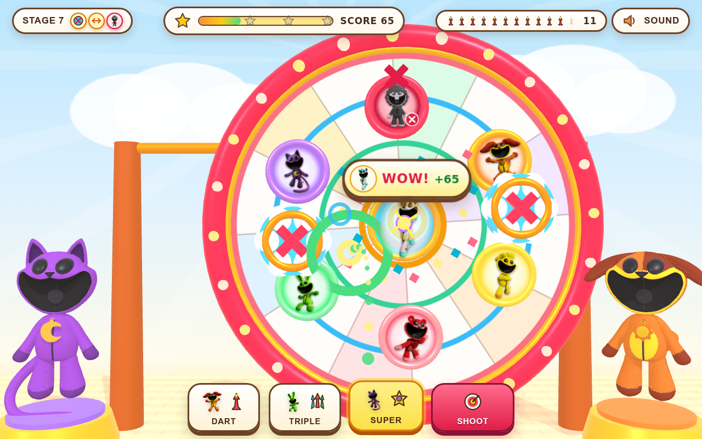

# 🎯 Critter Darts 3D: Sunny Carnival Target Shoot!

**Live Game (GitHub Pages):** [https://kunruiw1991.github.io/critters-darts3d/](https://kunruiw1991.github.io/critters-darts3d/)  
**Repository:** [https://github.com/kunruiw1991/critters-darts3d](https://github.com/kunruiw1991/critters-darts3d)

---

## 🌟 Highlights & Core Features

- **High-Resolution 3D Carnival Stage (`Three.js r161` WebGL)**:
  - **Smaller Critter Target Medallions (~50% of Board Area)**: Ferris-wheel upright-stabilized 3D Smiling Critter target pads (`Bobby BearHug`, `DogDay`, `CatNap`, `Hoppy Hopscotch`, `CraftyCorn`, `PickyPiggy`, `Bubba Bubbaphant`, `KickinChicken`, and `Baba Chops`) occupy ~50% of the dartboard disk area, leaving bright radial wedges and scoring rings exposed so every throw requires real accuracy.
  - **Full 3D `v11` Smiling Critter Stage Cheerleaders**: High-resolution 3D `CatNap` and `DogDay` plush models (`models/catnap_plush_base_model.glb` and `models/dogday_plush_base_model.glb`) cheering on golden left/right pedestals whenever you hit a friendly Critter!

- **3D Parabolic Ballistic Curve & Lead-Prediction Engine**:
  - **No Instant Hit-Scan**: Darts launch along a genuine 3D parabolic trajectory (`FLIGHT_DURATION = 0.44s`) with upward lob, gravity drop (`GRAVITY_DROP_Y = 0.52`), and spin curve drift (`CURVE_WIND_X = 0.14`) — clicking directly on a target's current position without accounting for the curve and board motion will miss!
  - **Kid-Friendly 3D Trajectory Arc & Lead-Prediction Reticle**: While aiming, a 16-pearl 3D parabolic curve connects your upper cyan sight ring to the gravity-dropped landing ring on the board, which dynamically glows **bright emerald green** when a friendly Critter will rotate/glide into that landing spot in `0.44s` (or **warning crimson** if an obstacle shield or Bad Baba Chops will arrive there).

- **Miss Penalty, Hazard Penalties & Negative Score `OUT!` Rule**:
  - **Friendly Critter Hit**: `+45` pts (outer ring) or `+65` pts (center bullseye) + streak bonus, triggering each Critter's adorable formant-synthesized vocal yell (`MEW!`, `YIP!`, `YAY!`, `WHEE!`, `WOW!`, `OINK!`, `TOOT!`, `PEEP!`) and 3D squash-and-stretch celebration.
  - **Miss Penalty (`MISS! -15`)**: Hitting empty dartboard wood between Critters or missing the board deducts `-15` pts and resets your combo streak.
  - **3D Obstacle Shield Penalty (`BLOCK! -15`)**: Hitting an orbiting 3D cloud-candy shield in Stage 2+ ricochets the dart away in 3D and deducts `-15` pts.
  - **Bad Baba Chops Penalty (`BAD! -25`)**: Hitting Naughty `Baba Chops` (marked with a crimson hazard ring and floating 3D red `✕`) in Stage 4+ triggers her mischievous bleat and deducts `-25` pts.
  - **Negative Score Bust (`<= -45` -> `OUT!`)**: If your score drops to `-45` or below, the round ends immediately with `OUT!` and a one-click `RETRY` picture button.

- **7 Progressive Carnival Stages (Tailored for a 5-Year-Old)**:
  - **Stage 1**: Classic gently rotating dartboard + ~50%-area Critter pads + parabolic curve & lead prediction.
  - **Stage 2**: Introduces **2 3D Orbiting Cloud-Candy Obstacle Shields** in front of the board (`BLOCK! -15`).
  - **Stage 3**: **Slowly Gliding 3D Dartboard** swaying smoothly side-to-side along the overhead carnival rail.
  - **Stage 4**: **Naughty Baba Chops Hazard Targets** (`BAD! -25`) mixed among friendly Critters.
  - **Stage 5 (Fusion 1)**: **3D Obstacle Shields + Slowly Gliding Dartboard**.
  - **Stage 6 (Fusion 2)**: **3D Obstacle Shields + Naughty Baba Chops**.
  - **Stage 7 (Grand Finale Fusion)**: **3D Obstacle Shields + Slowly Gliding Dartboard + Naughty Baba Chops**.

- **Top-3 Podium Qualification**:
  - 🥇 **1st Place (`>= 210` pts)**: `⭐⭐⭐` (`WIN!`, unlocks `NEXT`)
  - 🥈 **2nd Place (`>= 140` pts)**: `⭐⭐` (`CLEAR!`, unlocks `NEXT`)
  - 🥉 **3rd Place (`>= 80` pts)**: `⭐` (`CLEAR!`, unlocks `NEXT`)
  - **4th / 5th Place (`< 80` pts) or `<= -45` (`OUT!`)**: `0⭐` (`TRY!` / `OUT!`, `NEXT` hidden, must `RETRY`)
